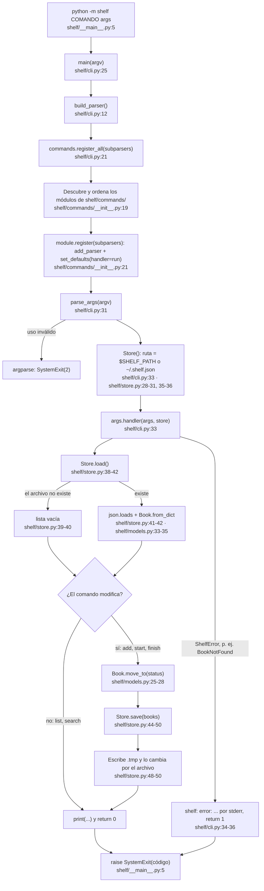
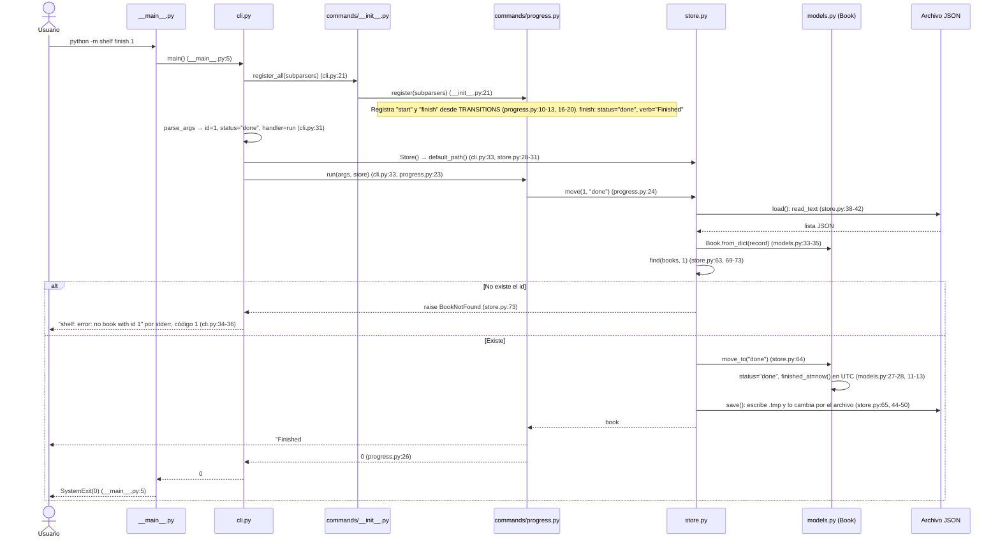

# Arquitectura de shelf

`shelf` es una CLI en Python 3.10+, solo con la biblioteca estándar. Cada comando pasa por las mismas cinco capas:

| Capa | Archivo | Responsabilidad |
|---|---|---|
| Entrada | `shelf/__main__.py` | Ejecuta `main()` y convierte su resultado en el código de salida. |
| CLI | `shelf/cli.py` | Construye el parser, despacha al handler y traduce `ShelfError` a código 1. |
| Comandos | `shelf/commands/*.py` | Un módulo por comando; cada uno define `register` y `run`. |
| Persistencia | `shelf/store.py` | Lee y escribe el archivo JSON de la estantería. |
| Modelo | `shelf/models.py` | `Book`, los estados válidos y las marcas de tiempo en UTC. |

## De un comando al archivo

Los comandos se descubren con `pkgutil.iter_modules`. Para añadir un comando basta con crear un archivo en `shelf/commands/`; no hay que editar ninguna lista compartida (`shelf/commands/__init__.py:7-9`).

## Secuencia de `shelf finish ID`

Cada `finish` sobrescribe `finished_at` con la hora actual, aunque el libro ya estuviera en `done`. Pasar a otro estado lo deja en `None` (`shelf/models.py:28`).
